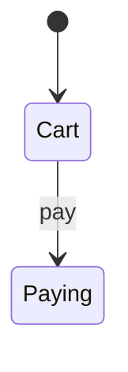

# Journeys

A journey is a realistic path a person takes to reach a goal, written down so a test can run it. Journeys are the human's main control over agents: the human approves what the product should do, and agents make it true.

## Choosing journeys

Start with what would cost the most if it broke: money, data, access, or trust. Ask what people came to do, then write those paths. Add a journey when a feature reads or changes data another feature owns.

Give each one a criticality:

- `critical`: the product is broken without it. Runs after every deploy as well.
- `important`: a real loss, with a workaround.
- `other`: everything else worth keeping.

A step counts only if its failure breaks the journey. Leave out secondary features such as suggestions.

## The format

Store journeys in `journeys/tests/`, one `<name>.journey.test.ts` file per journey. The spec check fails on a journey file anywhere else under `journeys/`. Each file holds both the approved description and the code that proves it, so the two can't drift apart. Write journeys in TypeScript whatever language the product uses, because they drive the product from outside.

The directory is protected. Changes to it need the owner's sign-off, as the project's `AGENTS.md` lists it. An agent proposes a change and never makes one alone.

```ts
// journeys/tests/buy-with-saved-card.journey.test.ts
import { NoDoubleCharge } from "../laws";

journey({
  title: "Buy a product with a saved card",
  criticality: "critical",
  level: "api",
  flow: "checkout",
  paths: ["src/cart/", "src/checkout/", "src/payments/"],
  persona: "Returning customer with a saved card",
  context: "Signed in, one in-stock item in the cart",
  intent: "Pay and get an order confirmation",
  breakWith: ["breaks/skip-order-status-update.patch"],
  productionSafe: true,
}, () => {
  test("WHEN a customer pays with a saved card, THE SYSTEM SHALL confirm the order", async () => {
    const shop = await openShop(returningCustomer());
    const order = await step("Submit the cart", () => shop.checkout());
    expect(order.status).toBe("pending");
    await step("Confirm payment", () => shop.pay(order.id));
    expect((await shop.getOrder(order.id)).status).toBe("paid");
    expect(shop.payments.charges()).toHaveLength(1);
  });

  prove({ proves: [NoDoubleCharge] }, "IF two tabs submit the same cart, THEN THE SYSTEM SHALL charge once", async () => {
    // Bad journeys live in the same file unless they have their own steps.
  });
});
```

| Field | Meaning |
|---|---|
| `title` | A short name a person would say, not an EARS sentence |
| `level` | `api`, `dom`, or `browser`. `api` calls the product's interface. `dom` renders the real page in a simulated DOM and sends its real requests to the real server, with no browser. `browser` drives a real browser. Prefer `dom` for page behavior when the stack can run it, because it's fast enough for the gate. Keep `browser` for what only a browser shows: startup wiring, hydration, the build, layout, and focus. If the product has no stable API, use `dom` or `browser`, and put service-level proofs in [checks](laws.md#proving-a-law). |
| `flow` | The [flow](#flows) this journey belongs to |
| `paths` | Which changes can affect this journey. The gate uses it to pick what runs. |
| `persona`, `context`, `intent` | Who is acting, from what starting state, and what they want |
| `breakWith` | Optional. Patches in `breaks/` that must make a test in this journey fail. Use one for a break no mutation tool can make: across several files, or one that changes meaning. The spec check fails until each named patch exists. |
| `productionSafe` | Optional. True if the journey can run against the real system. |

`journey()` is a small helper around the test runner's group function, and `prove()` wraps its test function for a test that proves a [law](laws.md). Start from [assets/journey.ts](../assets/journey.ts), and build both on the project's own test object, so its fixtures keep working. Their typed arguments make the compiler reject a misspelled field or an unknown `criticality`.

Keep the first argument of each a plain object literal, with no variables, spreads, or function calls, so that a script can read it without running anything. The one exception is `proves`, which holds law variables imported under their own names from `laws.ts`.

`proves` sits on the test, because a journey's other tests may not touch the law. If the project already links tests to expectation IDs, keep that mechanism, so each ID lives in one checked place.

Put setup and actions in `journeys/support/`, such as `shop.pay()`. Keep them thin, so a journey stays readable and a UI rename changes one helper. The helpers are protected too. On an existing project, reuse its helpers, and check that its import rules let journeys reach them.

Name each action with `step("Submit the cart", ...)`, using a plain string a person would understand. The journey page reads these names, so they're how the human follows the journey. On a runner with no step API, such as Vitest, `step()` can just run its body, because the page reads the name from the syntax tree.

Title each test with an EARS pattern. The shapes are in [writing-expectations](../../writing-expectations/SKILL.md#4-draft-and-check). Use `IF ..., THEN` for bad journeys.

When the test proves a line the human approved in a brief, start its title with the line's ID, such as `"TODO-7: WHEN a person adds a todo, THE SYSTEM SHALL show it first"`. The title is then the filed line, so it lives in one checked place. Each ID sits on one test. Its prefix names the feature that owns the line, and `journeys/spec.json` lists each feature's prefix. Every ID's prefix must be in that list, so a project that started using IDs before the list existed fails the check until it adds one. A withdrawn ID goes into `retiredIds` there and is never used again:

```json
{
  "prefixes": { "todos": "TODO", "reminders": "REM" },
  "retiredIds": ["TODO-6"]
}
```

## Who does what

1. An agent drafts the description, the test titles, and any flow or chart change, with empty test bodies.
2. The human approves them, along with any public interface the tests will call, such as routes, payloads, or commands. A journey, title, or chart that comes word for word from an approved brief is already approved, so show only what the brief didn't settle. This is the approval that counts, so show the description, titles, flow, and chart alone.
3. A tester agent writes the test bodies from the public interface, without reading the implementation. If you can't start one, for example because you are a subagent yourself, ask the session that started you to run the tester. Only when no session can, write the bodies yourself before you open the implementation, say so in the report, and treat the proofs as less independent.
4. Watch each test fail for the expected reason: on an assertion, not because the app won't start. A test that already passes on arrival must be seen to fail on a throwaway change to the code, which you then revert.

When new behavior makes a locked test wrong without changing its line, such as a reply that gains a field, the agent lists the test and why, the human approves the change, and the tester makes it. It changes only what the new behavior makes wrong, and may make a check stricter, never looser.
5. The human reviews the file once. It reaches `main` together with the code it proves, in one commit, after the owner signs off. It's locked from then on.

A later change to a journey or helper needs the same approval, including a change that only follows a UI rename. Never loosen one to get a pass.

## Bad journeys

Bad journeys are where most of the value is, because good paths rarely reach error-handling code. Walk the taxonomy in [Tier 1](../SKILL.md#tier-1-a-behavior-change) across the whole journey, then ask:

- What happens if the person stops halfway, retries, or goes back?
- What did the system already do when a step fails? Is that state left behind?
- Can someone who doesn't own this data reach it?
- Which step happens twice if a request is repeated?
- What has gone wrong here before? Every incident or reported bug becomes a bad journey.

A bad journey passes when the product fails safely: a clear outcome for the person, no lost or corrupted data, and no access granted. An error message on its own proves little, so check the state afterwards.

## Writing the test

- Drive the same interface a real client uses.
- Assert the outcome of each step, including what a failed step must leave behind. Pressing a key and moving on drives a path without checking it.
- In a `prove()` test, assert the law where it could break, and wait for the answer that settles it. A wait for the page to go quiet can read the state too early and pass on broken code.
- Read results back through the interface, such as fetching the order after paying.
- Create all data the journey needs, with unique IDs, through the fastest honest route. Seed lower steps directly when they aren't what this journey proves.
- Use a fake that can fail for third-party outages.

## Prove the journey can fail

A journey that has never failed proves little. Break the product on purpose in a throwaway branch: remove the fix, skip the charge, drop the permission check. The journey must fail for that reason. Then restore the code. If a mutation tool couldn't make that break, because it spans files or changes meaning, save it as a patch in `breaks/` and list it in `breakWith`, so the [break check](break-check.md) can repeat it. A mutation run on the changed lines repeats the simpler breaks later.

When no test catches a fault, write that down too. A recorded gap gets fixed. An unrecorded one stays hidden.

## Flows

A flow is one feature as a person experiences it, such as checkout or amending an order. Its page should let a newcomer learn what the feature does and how it works without asking anyone. Each flow has one source file, `journeys/flows/<flow>.flow.ts`, which holds the summary, terms, main code, decisions, and statechart. `flow()` comes from `tools/journey-spec/law.ts`:

```ts
// journeys/flows/checkout.flow.ts
flow({
  title: "Checkout",
  summary: "A signed-in customer pays for their cart, and the order is confirmed once the provider reports the payment.",
  terms: { "Saved card": "A card token kept with the provider, never the card number" },
  code: ["src/checkout/checkout.service.ts", "src/payments/charge.ts"],
  decisions: ["docs/decisions/0007-confirm-on-webhook.md"],
  chart: `stateDiagram-v2
    [*] --> Cart
    Cart --> Paying: pay
    Paying --> Confirmed: provider reports paid
    Paying --> Failed: card declined
    Failed --> Cart: try again`,
});
```

Keep the summary to a few sentences, and the first argument a plain object literal. Machines can check that a linked file exists, but not that a sentence is still true, so let the chart and journeys carry the detail.

The chart is a Mermaid `stateDiagram-v2`, written as a plain template string with no substitutions. Name states and transitions in the product's own words, and draw the failure paths as well as the good ones. A chart with more than about 15 states is too big to read, so split the flow. Mark a [known bug](laws.md#a-law-the-product-breaks-today) as a state with the class `broken`, and remove it with the fix.

The flow and chart are part of the approved design, and they're protected like the journeys. A model from the **create-formal-verification-skill** skill can check a chart against the product, and the **statechart** skill draws what it checked. Without one, nothing shows the product follows it.

## The journey pages

A project that uses this format generates a page for each flow at `journeys/docs/<flow>.md`, and an index at `journeys/docs/README.md`. They're what people read to learn how a feature works and what it promises, and nobody edits them by hand. The chart shows as a diagram in a viewer that renders Mermaid, such as GitHub or an editor preview.

The skill ships the generator, so don't write one. Set it up once per project:

1. Copy [scripts/journey-spec.mjs](../scripts/journey-spec.mjs) to `tools/journey-spec/`, because the gate must run without this skill installed. Add `oxc-parser` as a dev dependency. A compiler may offer no JavaScript API, so don't swap in `typescript`.
2. Copy [assets/law.ts](../assets/law.ts) and [assets/check.ts](../assets/check.ts) to `tools/journey-spec/`, and [assets/journey.ts](../assets/journey.ts) to `journeys/support/`. Then adapt the lines marked `RUNNER` to the project's test runner. A stack skill may ship its own versions of these, such as **typescript-stack**'s, so use those when it does.
3. Run `node tools/journey-spec/journey-spec.mjs generate` from the project root. Run it again in the same commit as any change to a page's sources.

It reads the laws file (`laws.ts` at the root, or the path in `laws` in `journeys/spec.json`), the flow files, the journey files, and every `check()` from the syntax tree, and it never runs them. It fails if any of these isn't a plain literal, or if a journey's `flow` has no flow file. To confirm it works, run [scripts/journey-spec-selftest.mjs](../scripts/journey-spec-selftest.mjs) from a directory that has `oxc-parser` installed.

A page also needs metadata on each converted test file, a flow file with a chart, and project rules that allow `journeys/docs/*.md` or a decision record where the project needs one. If any of these is missing or banned, stop and ask the human before adding them. Never produce the page another way, by hand or in another format.

A flow's page is written for the owner checking what the flow promises and what proves each promise. It looks like this:

````md
# Checkout

A signed-in customer pays for their cart, and the order is confirmed once the provider reports the payment.

## What it promises

| ID | Promise | Journey | Law |
| --- | --- | --- | --- |
| PAY-1 | WHEN a customer pays with a saved card, THE SYSTEM SHALL confirm the order | Buy a product with a saved card |  |
| PAY-2 | IF two tabs submit the same cart, THEN THE SYSTEM SHALL charge once | Buy a product with a saved card | NoDoubleCharge |

## Laws

- `NoDoubleCharge`. Must never happen: A customer is charged twice for one order. Proved by PAY-2 and the property check in [`src/payments/charge.test.ts`](../../src/payments/charge.test.ts).

## Known bugs

None.

## States

A model check tests this chart against the code.



## Journeys

### Buy a product with a saved card

Critical. Drives the API from [`journeys/tests/buy-with-saved-card.journey.test.ts`](../../journeys/tests/buy-with-saved-card.journey.test.ts).

- Who: Returning customer with a saved card
- Starting point: Signed in, one in-stock item in the cart
- Goal: Pay and get an order confirmation

Steps:

- PAY-1
  1. Submit the cart
  2. Confirm payment
- PAY-2

## Terms

- Saved card: A card token kept with the provider, never the card number

## Code

- [`src/checkout/checkout.service.ts`](../../src/checkout/checkout.service.ts)
- [`src/payments/charge.ts`](../../src/payments/charge.ts)

## Decisions

- [`docs/decisions/0007-confirm-on-webhook.md`](../../docs/decisions/0007-confirm-on-webhook.md)
````

The line under States depends on what exists: if no model checks the chart, it says people review it. Each `knownBroken` law sits under Known bugs, so a broken law never reads as a kept promise, and its proofs show "Fails today" in the promises table. Journeys, Terms, Code, and Decisions appear only when they have entries. Links are relative to `journeys/docs/`, so they open on GitHub and in an editor. The chart stays a Mermaid block: GitHub strips inline SVG and `data:` images from Markdown, and renders Mermaid itself. The page never shows whether a run passed. A commit can't contain its own result, so results go in the gate's output and the reply. The gate fails if a page is stale.

The index, `journeys/docs/README.md`, has a table of flows with their counts of promises, laws, and known bugs, then every law, then any journey file not converted yet.

To test a page, give it to a fresh agent with no other context, and ask it to explain the feature and find the code. Fix the flow file where the agent gets stuck.

## Existing projects

If the project already has its own spec format, such as expectation files and locks, treat it as the journeys and laws. Skip the file conventions in this file, and follow the project's ownership rules instead of [Who does what](#who-does-what). The human still approves what the product should do. Convert to this format only after the human says yes. An [audit](audit.md) ends by asking.

To convert, take one flow at a time, starting with the riskiest. The journey files not converted yet keep running in the gate, and the index lists them by name. Spec checks apply only to converted journeys, so old titles stay as they are until the human approves a change.

Before starting, check what the project's own rules will refuse, such as import boundaries, lint rules, dead-code checks, or bans on stray docs. Change those rules only with the human's approval.

## Hiding journeys from the builder

A builder that can read a journey can shape code to pass it. For high-risk work, keep some bad journeys outside the agent's worktree and run them only at the gate. On failure, tell the builder the behavior that failed, not the journey text.

Keep these out of `journeys/`, so the generated page doesn't expose them. The gate's results still show them.

## Using journeys in production

Set `productionSafe` on `critical` journeys where you can, and run them after each deploy. Use dedicated test accounts, and keep their data out of analytics.
